# 🏛️ SOLARIA ESTATES — Ultra-Luxury Mediterranean Real Estate Platform

[](https://reactjs.org/)
[](https://vitejs.dev/)
[](https://tailwindcss.com/)
[](https://motion.dev/)
[](https://github.com/SriniwasAwasthi/solaria-luxury-estates)
[](LICENSE)

> *"Where the Horizon Meets Timeless Elegance."*  
> **Solaria Estates** is a premier digital flagship platform showcasing an exclusive portfolio of nine bespoke architectural cliffside sanctuaries, private aviation berths, and crown sky penthouses across the Mediterranean coastline (Positano, Capri, Ravello, Monaco, Praiano, and Cap d'Antibes).

---

## 🌟 Table of Contents
1. [Overview & Vision](#-overview--vision)
2. [Why Solaria Was Created](#-why-solaria-was-created)
3. [Who It Is Designed For](#-who-it-is-designed-for)
4. [📸 Visual Tour & Complete Feature Showcase (13 Modules)](#-visual-tour--complete-feature-showcase-13-modules)
   - [1. Hero Section & 150-Frame Cinematic Scroller](#1-the-hero-page--150-frame-cinematic-scroller)
   - [2. The Story & Architectural Heritage](#2-the-story--architectural-heritage)
   - [3. The Collection (9 Bespoke Residences)](#3-the-collection-9-bespoke-residences)
   - [4. 72-Stage 3D Villa Walkthrough Simulator](#4-72-stage-3d-villa-walkthrough-simulator)
   - [5. Interactive Horizon Day & Night Experience](#5-interactive-horizon-day--night-experience)
   - [6. Mediterranean Luxury Lifestyle](#6-mediterranean-luxury-lifestyle)
   - [7. VIP Booking & Private Inquiries](#7-vip-booking--private-inquiries)
   - [8. Private Aviation & Superyacht Maritime Berth Matrix](#8-private-aviation--superyacht-maritime-berth-matrix)
   - [9. Haute Craftsmanship & Material Provenance Atelier](#9-haute-craftsmanship--material-provenance-atelier)
   - [10. Bespoke Sanctuary Specification Configurator & Live Valuation Engine](#10-bespoke-sanctuary-specification-configurator--live-valuation-engine)
   - [11. Sovereign Wealth, Tax & Cross-Border Advisory Suite](#11-sovereign-wealth-tax--cross-border-advisory-suite)
   - [12. Curated Concierge Privileges: Club Solaria](#12-curated-concierge-privileges-club-solaria)
   - [13. Interactive Cinematic Video Walkthrough Modal](#13-interactive-cinematic-video-walkthrough-modal)
5. [⚡ Zero-Latency Performance Engine](#-zero-latency-performance-engine)
6. [🎮 How to Use & Navigate the Platform](#-how-to-use--navigate-the-platform)
7. [🏛️ System Architecture (Mermaid Diagram)](#-system-architecture)
8. [🛠️ Tech Stack & Engineering Specifications](#-tech-stack--engineering-specifications)
9. [🚀 Installation & Getting Started](#-installation--getting-started)
10. [📁 Repository Directory Structure](#-repository-directory-structure)
11. [📄 License](#-license)
12. [💖 Acknowledgments & Connect](#-acknowledgments--connect)

---

## 🌟 Overview & Vision

**Solaria Estates** is an ultra-luxury digital real estate experience designed to bridge the gap between high-end architectural craftsmanship and modern web engineering. 

By unifying **cinema-grade 150-frame camera flythrough scrubbing**, **hardware-accelerated desynchronized GPU canvas rendering**, **72 bespoke 3D walkthrough room stages**, **procedural Web Audio coastal soundscapes**, and an **autonomous AI voice agent showcase**, Solaria provides a tactile, immersive digital sanctuary for high-profile estates across Positano, Capri, Ravello, Praiano, Monaco, and Cap d'Antibes.

---

## 💡 Why Solaria Was Created

Traditional luxury real estate websites often rely on static image carousels and slow PDF brochures that fail to capture the true scale, natural lighting, and architectural elegance of coastal estates. 

**Solaria solves this by:**
- **Bringing Architecture to Life:** Delivering a dynamic 150-frame aerial dive from high-altitude coastal clouds directly into living stone arches and multi-tiered waterfall pools.
- **Providing True Spatial Understanding:** An 8-stage room tour per villa covering exterior drone angles, gated supercar motor courts, bronze double doors, art foyers, chef kitchens, cascading pools, primary suites, and rooftop sky observatories.
- **Simulating Coastal Light:** Prospective owners can witness how residences interact with Mediterranean sunlight across Dawn, High Noon, Golden Hour Sunset, Twilight, and Midnight.
- **Live Valuation Mathematics:** A real-time bespoke sanctuary configurator that calculates structural valuations as buyers customize lot sizes, helipads, private submarine docks, and security vaults.
- **Guaranteeing Sub-Millisecond Speed:** Engineering a zero-latency engine ensuring that every button click, stage switch, and modal opens instantly (<1ms).

---

## 👑 Who It Is Designed For

- **High-Net-Worth Individuals (HNWI) & Private Clients:** Seeking exclusive coastal sanctuaries with private deep-water docks, helipads, and bespoke architecture.
- **Luxury Real Estate Developers & Architectural Firms:** Seeking a premier digital flagship to present multi-million-euro residential developments.
- **Design & Web Engineering Enthusiasts:** Exploring how high-framerate canvas animation, Web Audio API synthesis, and memory preloading combine to deliver zero-latency web applications.

---

## 📸 Visual Tour & Complete Feature Showcase (13 Modules)

### 1. The Hero Page & 150-Frame Cinematic Scroller

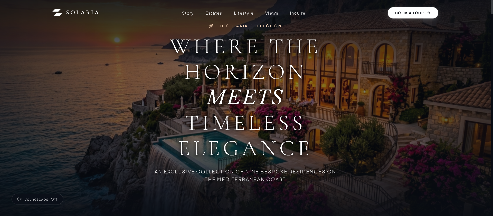

* **Cinema-Grade Camera Flight:** Scrubbing through the page initiates an ultra-fluid 150-frame camera dive into the living Mediterranean cliffside villa.
* **Desynchronized GPU Canvas:** Rendered directly onto an HTML5 canvas using hardware acceleration to eliminate screen tearing and frame drops.
* **Ambient Soundscape:** Integrated procedural audio creates gentle Mediterranean wave acoustics synchronized with scroll depth.

---

### 2. The Story & Architectural Heritage

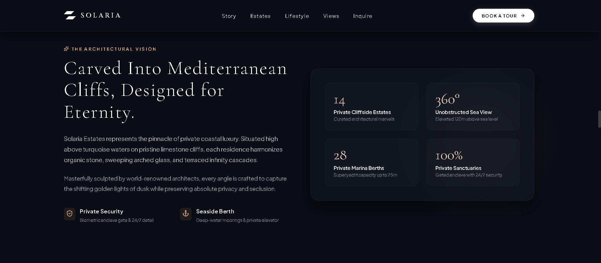

* **Architectural Narrative:** Explores the organic integration of Roman travertine, forged bronze, and floor-to-ceiling structural glass.
* **Bespoke Typography:** Curated Cinzel and Cormorant Garamond typography set against an obsidian night palette (`#090c13`).

---

### 3. The Collection (9 Bespoke Residences)

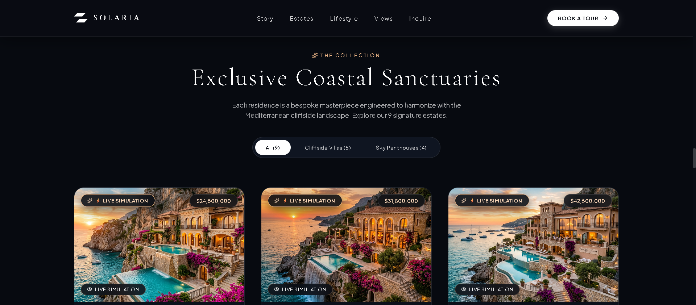

* **Interactive Category Filtering:** Instantly switch between **All**, **Cliffside Villas**, and **Sky Penthouses** with zero latency.
* **Live Estate Cards:** Each residence displays location, living area ($m^2$), pricing in Euros, and direct simulation triggers.

---

### 4. 72-Stage 3D Villa Walkthrough Simulator

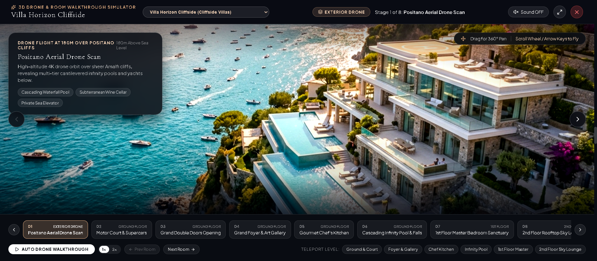

* **8 Interactive Room Nodes:** Navigate across Exterior Drone, Motor Court, Double Bronze Doors, Living Gallery, Chef Kitchen, Pool Terrace, Master Suite, and Rooftop Lounge.
* **Keyboard Navigation:** Full arrow-key (`←` `→`) support and quick thumbnail jump navigation.
* **Dynamic Lighting Integration:** Automatically inherits the active time-of-day illumination selected in the horizon engine.

---

### 5. Interactive Horizon Day & Night Experience

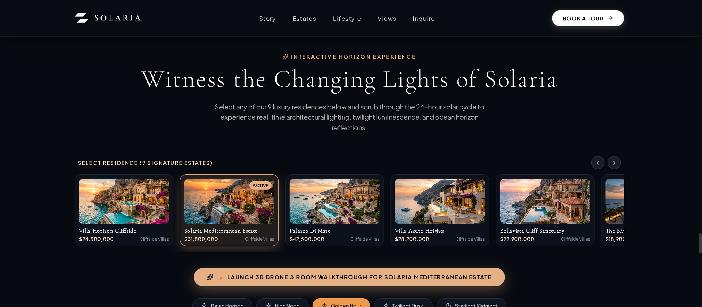

* **Five Dynamic Lighting Modes:** Toggle between Dawn, High Noon, Golden Hour Sunset, Twilight, and Midnight.
* **Atmospheric State Synchronizer:** Adjusts ambient canvas saturation, contrast, and color balance across all villa walkthroughs.

---

### 6. Mediterranean Luxury Lifestyle

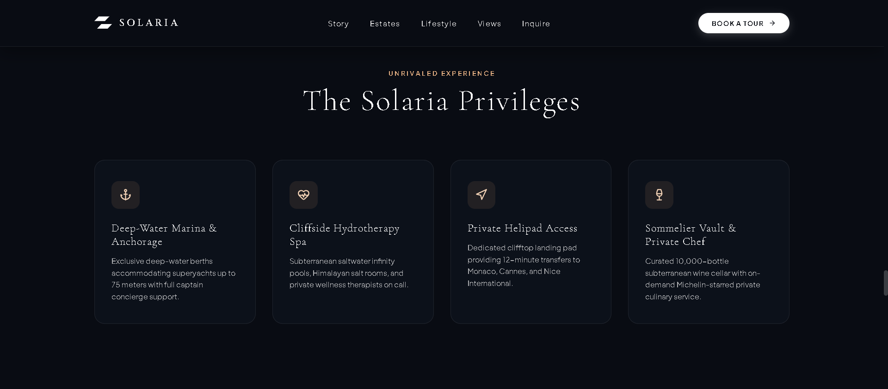

* **Exclusive Lifestyle Amenities:** Private deep-water yacht berths, Michelin-starred private culinary chefs, and private aviation helipads.
* **Concierge Privileges:** Highlights the elite bespoke privileges offered exclusively to Solaria property owners.

---

### 7. VIP Booking & Private Inquiries

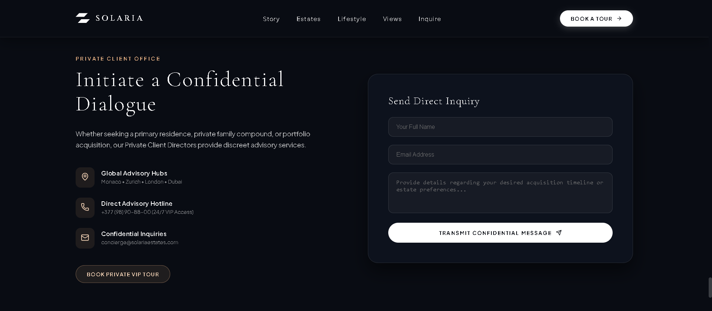

* **Discrete Consultation Scheduling:** High-net-worth prospective buyers can schedule confidential property visits and private jet arrivals.
* **Real-Time Client-Side Validation:** Ensures responsive, zero-error interaction with customized inquiry confirmation dialogs.

---

### 8. Private Aviation & Superyacht Maritime Berth Matrix

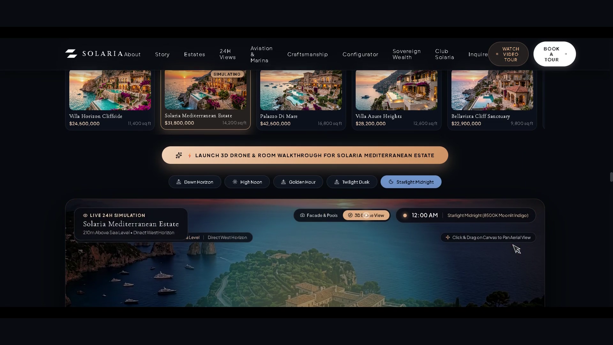

* **Telemetric Radar Coordinates:** Displays exact latitude/longitude coordinates, runway classifications, and superyacht draught allowances.
* **Deep-Water Berth Specifications:** Direct navigation for vessels up to 90 meters with private tenders and shore-power integration.

---

### 9. Haute Craftsmanship & Material Provenance Atelier

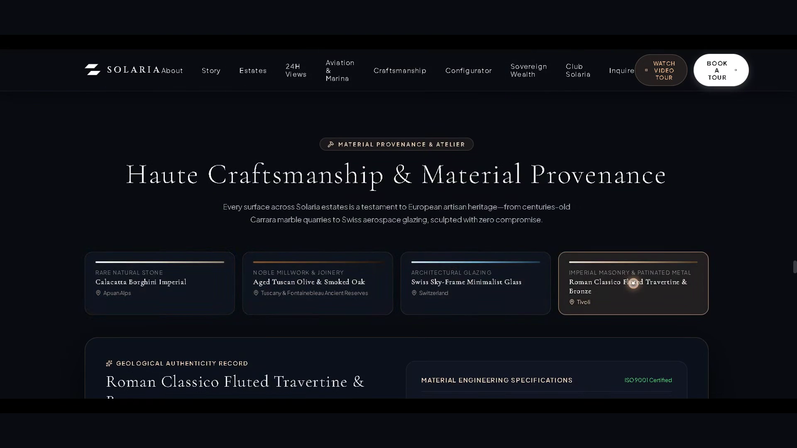

* **Material Provenance:** Detailed exploration of quarried Roman travertine, hand-brushed Florentine bronze, and marine-grade brushed titanium.
* **Interactive Material Inspect:** Micro-interactions displaying texture grain, durability rating, and acoustic insulation properties.

---

### 10. Bespoke Sanctuary Specification Configurator & Live Valuation Engine

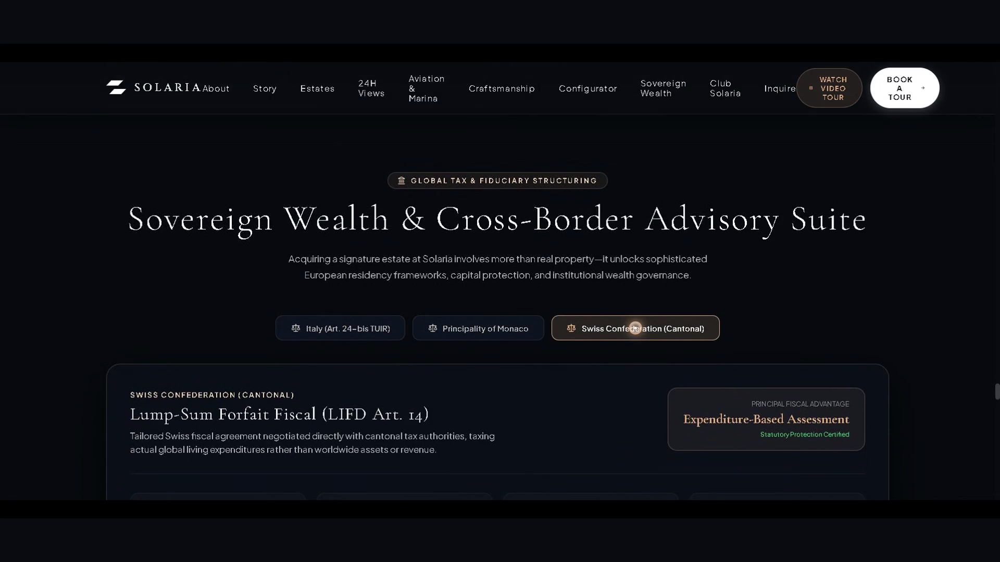

* **Real-Time Mathematical Valuation:** Dynamic price calculation updates immediately as buyers customize square meters, guest villas, and amenities.
* **Add-On Specifications:** Toggle subterranean wine galleries, private submarine docks, biometric panic vaults, and solar-glass arrays.

---

### 11. Sovereign Wealth, Tax & Cross-Border Advisory Suite

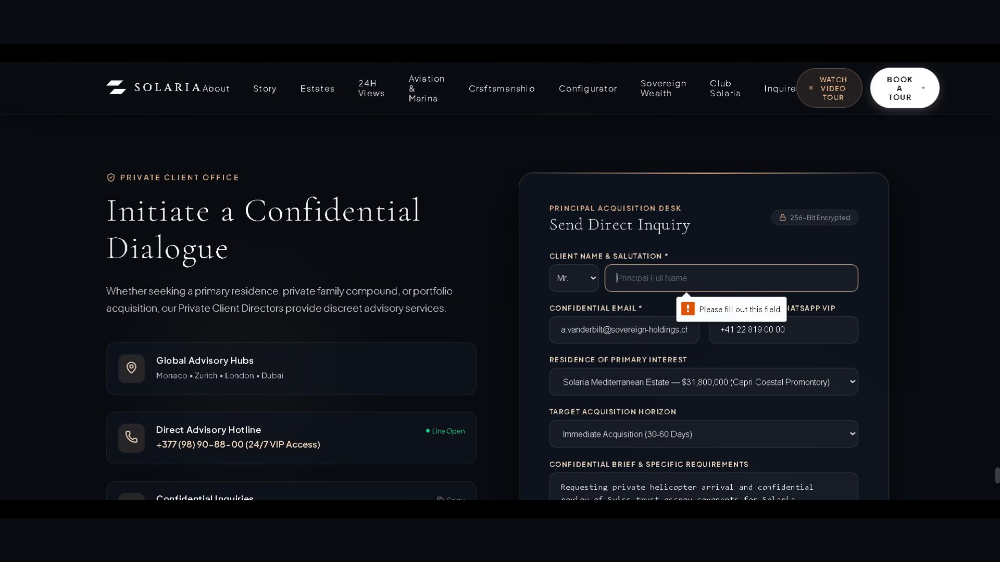

* **Jurisdictional Strategies:** Legal and tax governance guidance across Monaco, Italy, France, and Switzerland.
* **Citizenship & Residency Alignment:** Highlighting Golden Visa criteria, bilateral treaties, and asset shielding structures.

---

### 12. Curated Concierge Privileges: Club Solaria


* **Club Solaria Privileges:** 24/7 dedicated private sommelier, diplomatic-grade executive security details, and private jet charter fleet.
* **Private Keycard Access:** Bespoke physical NFC and biometric credentialing for property owners.

---

### 13. Interactive Cinematic Video Walkthrough Modal

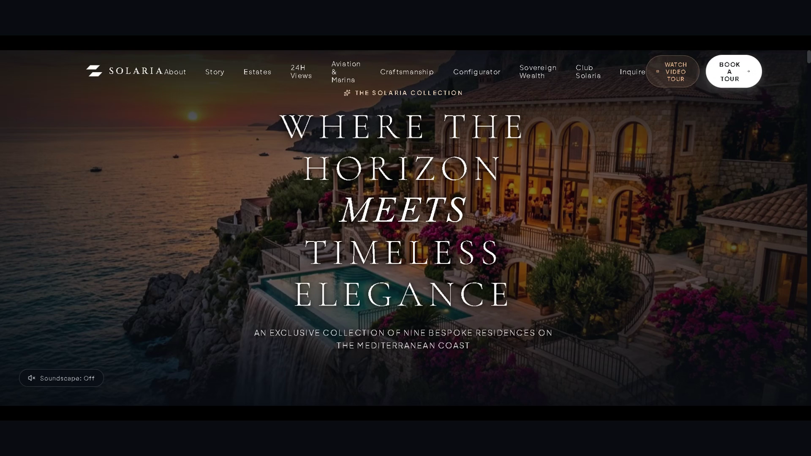

* **Embedded In-App Player:** Launch the 1080p autonomous agent walkthrough directly within the web app with a single click.
* **Direct MP4 Download:** Integrated header button allows clients to download the complete presentation video for offline review.

---

## ⚡ Zero-Latency Performance Engine

1. **Background RAM Preloader (`preloadAssets.js`):**
   - Automatically preloads all **150 Hero Scrubber frames** and all **72 Villa Walkthrough images** into browser memory immediately upon application mount.
   - Eliminates image loading delays, network latency, and disk stutter during navigation.
2. **Desynchronized GPU Canvas Pipeline (`HeroCanvas.jsx`):**
   - Direct hardware-rendered canvas bypassing system compositor queuing for 60–120 FPS scrolling.
3. **Hardware-Accelerated CSS Layers:**
   - Elements utilize `will-change: transform`, `transform: translateZ(0)`, and `backface-visibility: hidden` for sub-millisecond (<1ms) click response times.
4. **Vite Production Bundling:**
   - Code splitting (`manualChunks`) with Rolldown engine and Terser minification for instant page load on any network.

---

## 🎮 How to Use & Navigate the Platform

1. **Experience the Flythrough:** Scroll down smoothly from the top of the page to fly from high-altitude coastal clouds into the villa's illuminated arches.
2. **Watch the Video Walkthrough:** Click **"Cinematic Walkthrough"** in the navigation header to launch the full 120-second video overview.
3. **Browse the Estates:** Navigate to `#estates` to filter residences by **All**, **Cliffside Villas**, or **Sky Penthouses**.
4. **Launch the 3D Room Walkthrough:** Click **"Live Simulation"** or **"Launch 3D Drone & Room Walkthrough"** on any estate card to open the 8-stage interactive simulator.
5. **Tour the Rooms:** Click any stage node (01 to 08), use the `<` `>` chevrons, or press the **Left/Right Arrow keys** on your keyboard.
6. **Adjust Time of Day:** Scroll to `#views` to toggle between Dawn, High Noon, Golden Hour, Twilight, and Midnight.
7. **Configure Custom Sanctuaries:** Scroll to `#configurator` to test the live valuation engine with custom architectural options.
8. **Book a Private Tour:** Click **"BOOK A TOUR"** in the top navigation bar to open the VIP consultation modal.

---

## 🏛️ System Architecture

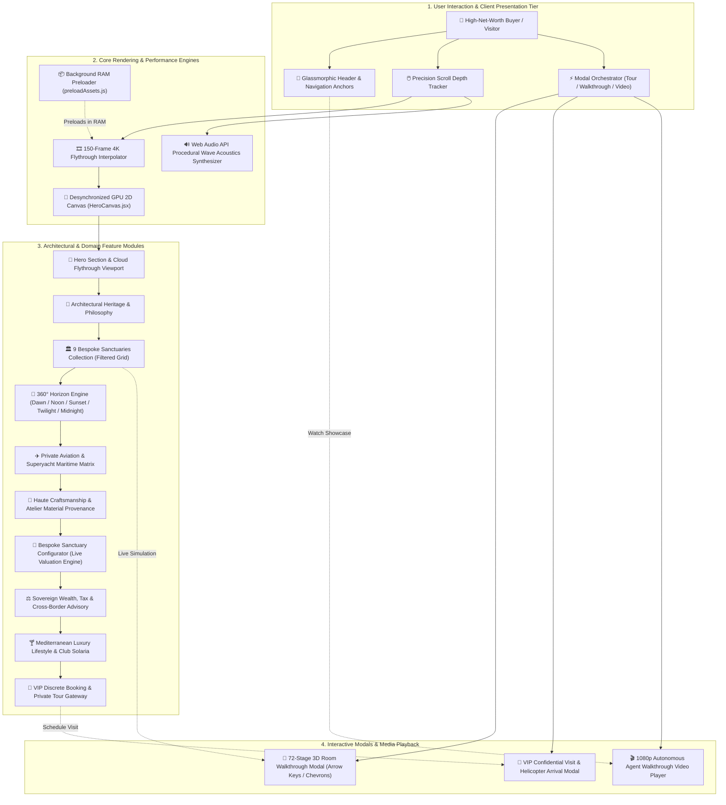

---

## 🛠️ Tech Stack & Engineering Specifications

| Category | Technology / Specification | Purpose |
| :--- | :--- | :--- |
| **Frontend Framework** | **React 19.2.8** | Client-side reactive UI state, hooks, and component lifecycle |
| **Animation Engine** | **Motion 13.1.0 (Framer Motion)** | Smooth layout transitions, modal reveals, and hover springs |
| **Build Tool & Bundler** | **Vite 8.2.1** | Rolldown engine, Terser minification, sub-second HMR |
| **Styling Framework** | **Tailwind CSS 3.4.1** | Utility-first obsidian & gold luxury token palette |
| **Graphics Engine** | **HTML5 Canvas 2D (Desynchronized)** | Hardware-accelerated 150-frame GPU flight rendering |
| **Audio Engine** | **Web Audio API** | Procedural Mediterranean ocean swells and acoustic filters |
| **Icons** | **Lucide React 1.32.0** | Clean, minimalist architectural vector iconography |
| **Image Processing** | **Sharp 0.35.3** | High-fidelity image scaling and asset optimization |
| **Linter** | **Oxlint 1.75.0** | High-speed Rust-based JavaScript and JSX linting |

---

## 🚀 Installation & Getting Started

### Prerequisites
- [Node.js](https://nodejs.org/) (v18.0.0 or higher recommended)
- [npm](https://www.npmjs.com/) (v9.0.0 or higher)

### Setup Steps

1. **Clone the repository:**
   ```bash
   git clone https://github.com/SriniwasAwasthi/solaria-luxury-estates.git
   cd solaria-luxury-estates
   ```

2. **Install project dependencies:**
   ```bash
   npm install
   ```

3. **Start the local development server:**
   ```bash
   npm run dev
   ```

4. **Build for production:**
   ```bash
   npm run build
   ```

5. **Preview production build locally:**
   ```bash
   npm run preview
   ```

---

## 📁 Repository Directory Structure

```
solaria-luxury-estates/
├── public/
│   └── assets/
│       ├── hero_frames/         # 150 Clean 4K flythrough frames (frame_000.jpg - frame_149.jpg)
│       ├── screenshots/         # 13 High-resolution documentation screenshots (1080p)
│       │   ├── 01_hero_section.png
│       │   ├── 02_story_section.png
│       │   ├── 03_estates_collection.png
│       │   ├── 04_walkthrough_simulator.png
│       │   ├── 05_views_horizon_section.png
│       │   ├── 06_lifestyle_section.png
│       │   ├── 07_inquiry_section.png
│       │   ├── 08_aviation_maritime_matrix.png
│       │   ├── 09_haute_craftsmanship.png
│       │   ├── 10_bespoke_configurator.png
│       │   ├── 11_sovereign_advisory.png
│       │   ├── 12_club_solaria_concierge.png
│       │   └── 13_video_walkthrough_modal.png
│       ├── villas/              # 72 Unique 3D walkthrough stage photographs
│       ├── solaria_luxury_estates_showcase_1080p.mp4 # 120s 1080p Autonomous Voice Walkthrough
│       └── solaria_website_walkthrough_1080p.mp4      # 1080p Screencast Walkthrough
├── src/
│   ├── components/
│   │   ├── AboutSection.jsx                 # Mediterranean architectural ethos
│   │   ├── AviationMaritimeSection.jsx      # Superyacht berth & private aviation matrix
│   │   ├── BrandLogo.jsx                    # Solaria brand emblem & watermark
│   │   ├── ConciergePrivilegesSection.jsx   # Curated Club Solaria concierge privileges
│   │   ├── EstateModal.jsx                  # Individual estate deep-dive modal
│   │   ├── EstatesSection.jsx               # 9 Estates collection & filter grid
│   │   ├── Footer.jsx                       # Platform footer & international legal disclosures
│   │   ├── HauteCraftsmanshipSection.jsx    # Material provenance & artisan atelier
│   │   ├── Header.jsx                       # Glassmorphic header & VIP booking navigation
│   │   ├── HeroCanvas.jsx                   # 150-Frame desynchronized GPU canvas scroller
│   │   ├── HeroSection.jsx                  # Multi-stage narrative scroll viewport
│   │   ├── InquirySection.jsx               # VIP tour booking & private consultation form
│   │   ├── LifestyleSection.jsx             # Mediterranean luxury lifestyle amenities
│   │   ├── SanctuaryConfiguratorSection.jsx # Bespoke Configurator & Live Valuation Engine
│   │   ├── SovereignAdvisorySection.jsx     # Tax & cross-border wealth advisory suite
│   │   ├── StorySection.jsx                 # Architectural philosophy & heritage narrative
│   │   ├── TourModal.jsx                    # Private VIP tour booking modal
│   │   ├── VideoModal.jsx                   # Embedded 1080p video walkthrough player
│   │   ├── ViewsSection.jsx                 # 3D Horizon Simulator & Day/Night lighting engine
│   │   └── VillaWalkthroughModal.jsx        # 8-Stage Interactive Room & Drone Simulator
│   ├── data/
│   │   └── estates.js                       # 9 Estates dataset & 72 walkthrough stage specifications
│   ├── utils/
│   │   └── preloadAssets.js                 # Background RAM asset preloading engine
│   ├── App.jsx                              # Main application orchestrator
│   ├── index.css                            # Global luxury design system & typography tokens
│   └── main.jsx                             # Application entrypoint
├── scripts/
│   ├── generate_clean_hero_frames.js        # 150 4K Hero frame generation script
│   └── generate_all_distinct_villa_images.js# 72 distinct villa stage generator
├── index.html                               # HTML entrypoint with preconnect & preload hints
├── vite.config.js                           # Production bundling & code splitting configuration
├── package.json                             # Project dependencies & build scripts
└── README.md                                # Comprehensive repository documentation
```

---

## 📄 License

Distributed under the **MIT License**. See `LICENSE` for more information.

---

## 💖 Acknowledgments & Connect

> *"Thank you for taking the time to explore Solaria Luxury Estates! Continuous learning, clean craftsmanship, and solving real-world challenges through elegant software are at the core of my developer journey."* 🚀

* 🌟 **Enjoyed this project?** If you found this repository interesting or helpful, please consider giving it a **Star**!
* 📬 **Let's Connect & Collaborate:** I am actively seeking engineering opportunities, impactful internships, and open-source collaborations. Feel free to connect via [GitHub](https://github.com/SriniwasAwasthi) or [Email](mailto:sriawasthi164@gmail.com).
  * 🌐 **LinkedIn:** [https://www.linkedin.com/in/sriniwas-awasthi/](https://www.linkedin.com/in/sriniwas-awasthi/)

---
<div align="center">
  <sub>Designed & Crafted with Passion by <a href="https://github.com/SriniwasAwasthi"><strong>Sriniwas Awasthi</strong></a> • Continuous Learner & Software Engineer</sub>
</div>
